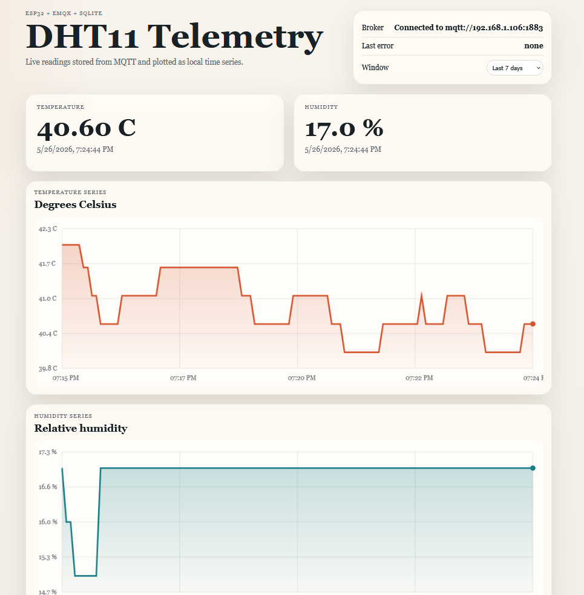

# MQTT DHT11 Dashboard

Small local Node app that:

- subscribes to `esp32/temperature/dht11` and `esp32/humidity/dht11`
- stores every MQTT reading in SQLite
- serves a browser dashboard with both time series



## Run

```sh
npm install
npm start
```

Then open `http://localhost:3000`.

## Run with Docker Compose

```sh
docker compose up --build
```

Then open `http://localhost:3000`.

The SQLite database stays on the host in `./data` through the compose volume mount.

## Optional environment variables

```sh
MQTT_HOST=192.168.1.106
MQTT_PORT=1883
MQTT_USERNAME=
MQTT_PASSWORD=
PORT=3000
```

The SQLite database is created at `data/readings.sqlite`.
